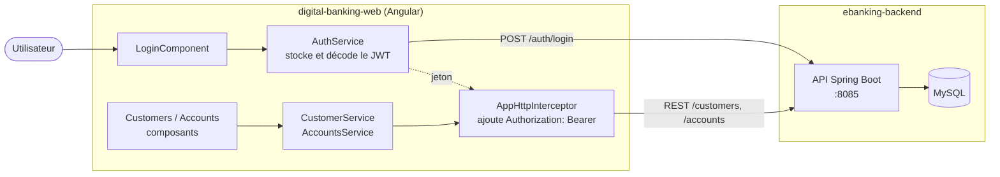

# Digital Banking Web — frontend Angular

[](https://github.com/erryhany/digital-banking-web/actions/workflows/ci.yml)


Interface web de l'application **Digital Banking** : connexion par JWT, gestion des clients, consultation des comptes et opérations bancaires (débit, crédit, virement) avec historique paginé.

> ⚙️ **Backend Spring Boot** : [erryhany/ebanking-backend](https://github.com/erryhany/ebanking-backend)
> Les deux dépôts forment une application full-stack. La stack complète (MySQL + backend + frontend) se lance en une commande depuis le dépôt backend.

## Architecture



## Fonctionnalités

- **Authentification** : formulaire de connexion, récupération et décodage du JWT (`jwt-decode`), déconnexion
- **Intercepteur HTTP** : ajout automatique de l'en-tête `Authorization: Bearer <token>` à chaque appel de l'API
- **Clients** : liste, recherche par mot-clé, création (formulaire réactif avec validation), suppression
- **Comptes** : recherche d'un compte, solde et historique des opérations paginé
- **Opérations** : débit, crédit et virement depuis l'interface
- **Configuration par environnement** : URL de l'API dans `src/environments/`

## Stack technique

| Couche | Technologies |
|---|---|
| Framework | Angular 13 (NgModule, Router, Reactive Forms, HttpClient) |
| Langage | TypeScript |
| UI | Bootstrap 5, Bootstrap Icons |
| Sécurité | JWT, intercepteur HTTP |
| Tests | Jasmine, Karma |
| Déploiement | Docker (build multi-étapes + Nginx), GitHub Actions |

## 🚀 Démarrage rapide avec Docker (application complète)

Depuis le dépôt backend, qui contient le `docker-compose.yml` :

```bash
git clone https://github.com/erryhany/ebanking-backend.git
cd ebanking-backend
cp .env.example .env        # puis renseigner JWT_SECRET et DB_PASSWORD
docker compose up -d --build
```

| Ressource | URL |
|---|---|
| Application web | http://localhost:4200 |
| API | http://localhost:8085 |
| Swagger UI | http://localhost:8085/swagger-ui.html |

## Développement local

Prérequis : Node.js 16 et le [backend](https://github.com/erryhany/ebanking-backend) démarré sur le port 8085.

```bash
git clone https://github.com/erryhany/digital-banking-web.git
cd digital-banking-web
npm install
npm start                   # http://localhost:4200
```

L'URL de l'API se configure dans `src/environments/environment.ts` (développement) et `environment.prod.ts` (production).

## Tests

```bash
npm test                    # mode interactif
npm run test:ci             # une seule exécution, Chrome headless
```

## Structure du code

```
src/app/
├── login/              → formulaire de connexion
├── admin-template/     → mise en page des pages protégées (navbar + contenu)
├── navbar/             → navigation et déconnexion
├── customers/          → liste et recherche des clients
├── new-custumer/       → création d'un client
├── customer-accounts/  → fiche d'un client
├── accounts/           → compte, historique et opérations
├── services/           → AuthService, CustomerService, AccountsService
├── interceptors/       → AppHttpInterceptor (JWT)
└── model/              → interfaces Customer, AccountDetails
```

## Pistes d'évolution

- Garde de route (`CanActivate`) et gestion de l'expiration du jeton
- Liste des comptes d'un client sur sa fiche
- Migration vers une version récente d'Angular (composants standalone)

## Auteur

**Mourad Erryhany** — Développeur Java / Spring Boot · [GitHub](https://github.com/erryhany) · [LinkedIn](https://www.linkedin.com/in/erryhany-mourad/)
